  

I spent four years as a Technical Account Manager at AWS, keeping other people's live systems up: $2.7M in new annual contract value and 94% retention across 10+ enterprise accounts. Before that I wrote C++ that turns live sonar into 3D seafloor maps.

Now I'm pointing all of that at race telemetry and trackside tech. I have not worked in motorsport yet, so I'm doing the part I can do from a desk: building the plumbing, small, in public, and writing down what I learn.

**Open to** roles in race and telemetry engineering, technical account management, and data and AI solutions. Calgary, ready to relocate.

## On track

| Build | What it does | The idea in it |
| --- | --- | --- |
| [**Mol-Bhav Meter**](https://github.com/daksh2197/mol-bhav-meter) [Try it live](https://daksh2197.github.io/mol-bhav-meter/) | A vendor says a price. You get a straight answer: great deal, bargain, or walk away. | Keep the math apart from the screen, so it can be tested without opening a browser |
| [**Résumé Pipeline**](https://github.com/daksh2197/resume-pipeline) [See the sample report](https://daksh2197.github.io/resume-pipeline/) | Ranks a daily list of job leads against my own rubric, then drafts a tailored application. I press send. | Every point in a score comes with the reason it was given |
| [**Interview Room**](https://github.com/daksh2197/interview-room) [Try it live](https://daksh2197.github.io/interview-room/) | A mock interviewer that asks one question at a time and grades STAR answers. | A suggested rewrite gets thrown out if it uses numbers the candidate never said |
| [**Pitwall Telemetry**](https://github.com/daksh2197/pitwall-telemetry) [Watch the replay](https://daksh2197.github.io/pitwall-telemetry/) | A race telemetry pipeline in miniature: CAN frames from a fake car, over a bad radio link, onto a pit-wall screen. | When the link drops, the car keeps the frames and fills the gap once it's back |

## In the garage

Next out: the true cost of a Rockies road trip from live open data, a walk-versus-savings ranker for pickup spots, a max-bid calculator built on real Canadian auction results, and a private, local-first ledger for bullion and collector coins.

## How I build

- **With Claude as my pair programmer.** I bring the problem and decide what the thing should do. Claude writes most of the code. I review it until I can explain every file. Every commit carries the co-author line.
- **Every repo has a `CTO-NOTES.md`.** The ideas in it, where things live, what to check when it breaks, and five small changes to try. It's my study guide, in public.
- **Nothing ships without tests and a second pair of eyes.** Each README has a "what got caught" section. It's usually the most useful part.

## Receipts

- Minor planet [31400 Dakshdua](https://ssd.jpl.nasa.gov/tools/sbdb_lookup.html#/?sstr=31400) is named after me. NASA's database will confirm it.
- Intel ISEF 2014: Best of Category and First Award in Animal Sciences. [Society for Science has the list.](https://www.societyforscience.org/press-release/intel-isef-2014-grand-award-winners/)
- The rest of the story, with the photos, is at [dakshdua.ca](https://dakshdua.ca). I'm also on [LinkedIn](https://www.linkedin.com/in/dakshjustduait).
